Classifying contract provisions: a LEDGAR study in R
================

- [Summary](#summary)
- [1. Data](#1-data)
- [2. Cleaning](#2-cleaning)
- [3. Features](#3-features)
- [4. Models](#4-models)
- [5. Validation of the final model](#5-validation-of-the-final-model)
- [6. Robustness](#6-robustness)
- [7. Comparison with a fine-tuned
  transformer](#7-comparison-with-a-fine-tuned-transformer)
- [8. Limitations](#8-limitations)
- [Reproducing](#reproducing)

## Summary

**Task.** Assign each contract provision in LEDGAR (LexGLUE; 80,000
provisions from SEC filings) to one of 100 provision types.

**Final model.** TF-IDF over word 1-2-grams plus a down-weighted block
of n-grams from the first 20 words of the provision, fed to a
one-vs-rest linear SVM with C = 1, trained on the cleaned train +
validation splits.

**Held-out test performance** (10,000 provisions, scored only after the
model was frozen):

| Metric                | Estimate | 95% bootstrap interval |
|-----------------------|----------|------------------------|
| Accuracy (= micro-F1) | 89.3%    | 88.8% – 90.0%          |
| Macro-F1              | 84.8%    | 83.4% – 85.7%          |
| Top-3 accuracy        | 95.8%    |                        |

The published LexGLUE models are trained on the training split only. The
same pipeline fitted that way scores 88.7% accuracy and 83.6% macro-F1
on test, against 87.2 / 82.4 for LexGLUE’s TF-IDF + SVM baseline and
88.6 / 83.6 for its best transformer (RoBERTa-large). A carefully tuned
sparse linear model is therefore on par with the published transformer
results on this task; differences of a few tenths of a point are inside
the bootstrap interval.

**Against a fine-tuned transformer.** Legal-BERT-small, fine-tuned on
the same training split within a CPU-only budget (3 epochs, 2.9 h),
reaches 86.1% accuracy and 78.1% macro-F1 on test — -2.6 pp and -5.5 pp
relative to the SVM trained on the same split (section 7). It had not
converged, so this understates what a transformer can do with more
compute.

**Why the number can be trusted.**

- *Target shuffling.* With labels permuted, the complete cross-validated
  pipeline scores 2.3% accuracy on average (maximum over 100
  permutations: 3.1%) against 80.0% with the real labels on the same
  sample: the pipeline cannot manufacture signal.
- *Resampling.* 5-fold stratified CV, repeated with three fold
  assignments: fold-to-fold SD 0.26 pp, repeat-to-repeat SD 0.11 pp.
- *Two untouched hold-outs.* Model families rank the same way on the
  validation split as in CV, and the test split was scored exactly once.

**What limits it.**

- The largest single sources of error are near-synonymous labels
  (Applicable Laws vs Governing Laws, Definitions vs Defined Terms, …):
  the 20 most confused pairs account for 25% of all test errors, and
  they are a property of the label scheme.
- Performance depends on how familiar a provision looks. Test provisions
  with a near-twin in the training data (cosine ≥ 0.95) are classified
  with 98.7% accuracy; those with no close neighbour (cosine \< 0.4)
  with about 77.0%.
- The official splits are chronological and their label mix drifts. The
  same train-only model scores 88.0% in random-fold CV, 88.6% on
  validation and 88.7% on test, so there is no sign of degradation on
  later filings — but that is an observation about the two periods this
  corpus covers, not a guarantee.

## 1. Data

LEDGAR (Tuggener et al., 2020) as packaged in LexGLUE (Chalkidis et al.,
2022): 80,000 provisions in three official splits (60,000 / 10,000 /
10,000), one label out of 100 per provision. `analysis/01_acquire.R`
downloads the parquet files and records checksums.

### Labels

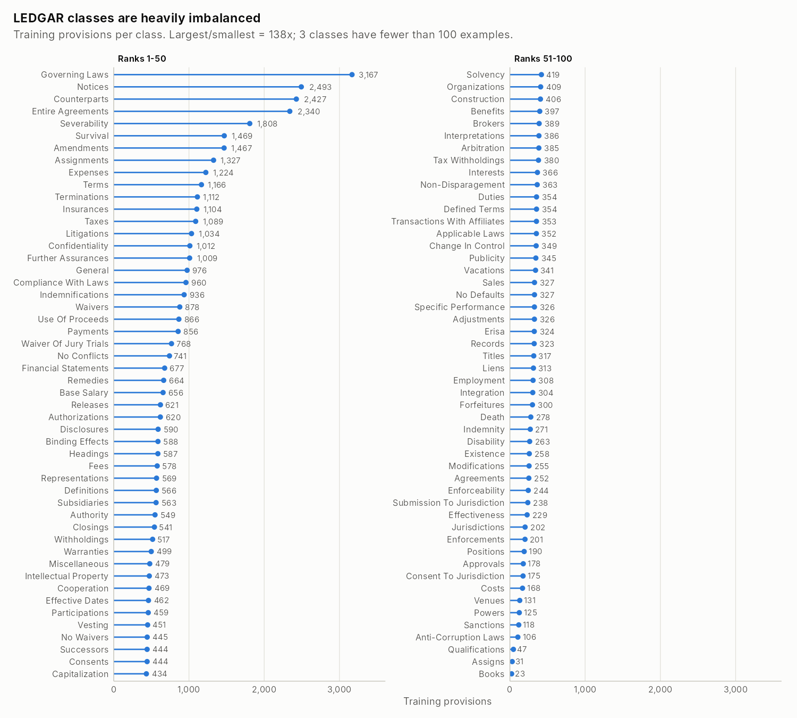<!-- -->

Class sizes range from 23 to 3,167 training examples (138×); the
effective number of classes is 74. Always predicting the largest class
would be right 5.3% of the time. Accuracy alone would hide failures on
small classes, so macro-F1 is reported throughout.

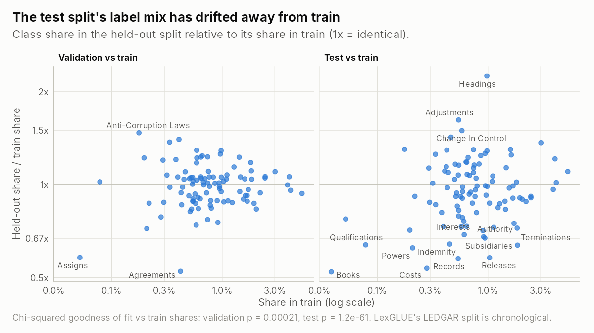<!-- -->

The validation label mix is close to train, the test mix is not (χ²
goodness of fit p = 1.2e-61). LexGLUE splits LEDGAR by filing year, so
this is drift over time. Whether it costs accuracy on later filings is
tested in section 6 (it does not, measurably).

### Text

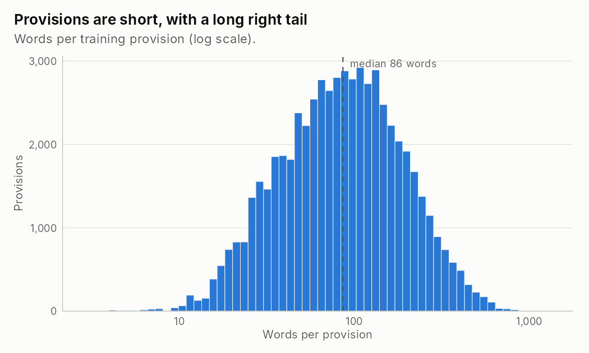

Provisions are short (median 86 words, 99th percentile 471). Length
varies systematically by class:

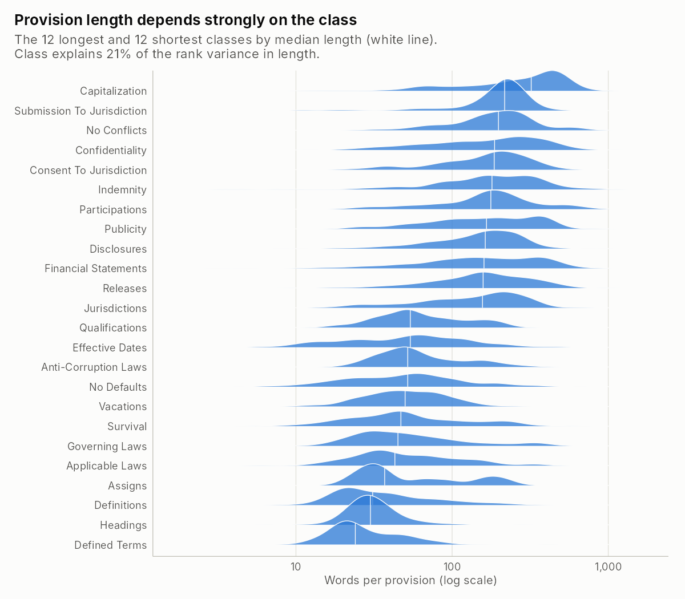<!-- -->

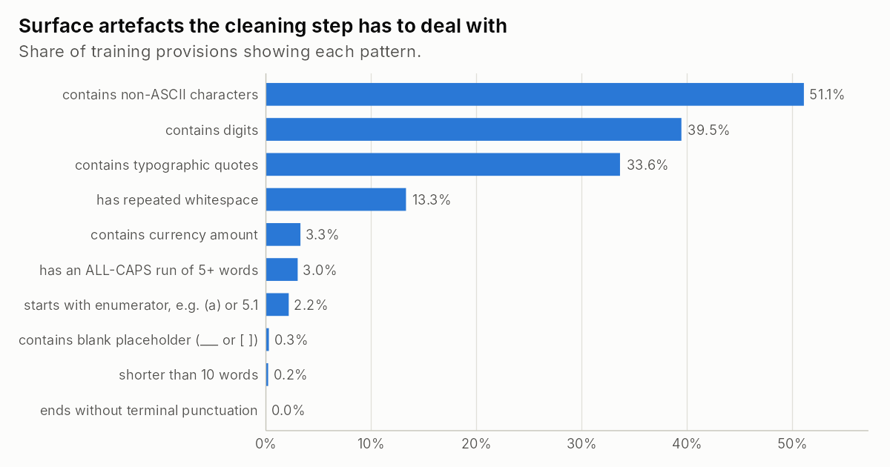<!-- -->

Numbers, section enumerators and typographic characters are common and
carry no information about the provision type, which motivates digit
masking and character repair in the cleaning step.

### Duplicates and leakage

There are no exact duplicate texts anywhere in the corpus. After masking
digits, case and punctuation (“template” fingerprint), however:

| Check                                                   | Rows | Share |
|:--------------------------------------------------------|-----:|:------|
| train: rows that repeat an earlier exact text           |    0 | 0.00% |
| train: rows that repeat an earlier template             | 2036 | 3.39% |
| train: rows in a template group with conflicting labels |   39 | 0.07% |
| validation: rows whose exact text is in train           |    0 | 0.00% |
| test: rows whose exact text is in train                 |    0 | 0.00% |
| validation: rows whose template is in train             |  543 | 5.43% |
| test: rows whose template is in train                   |  580 | 5.80% |

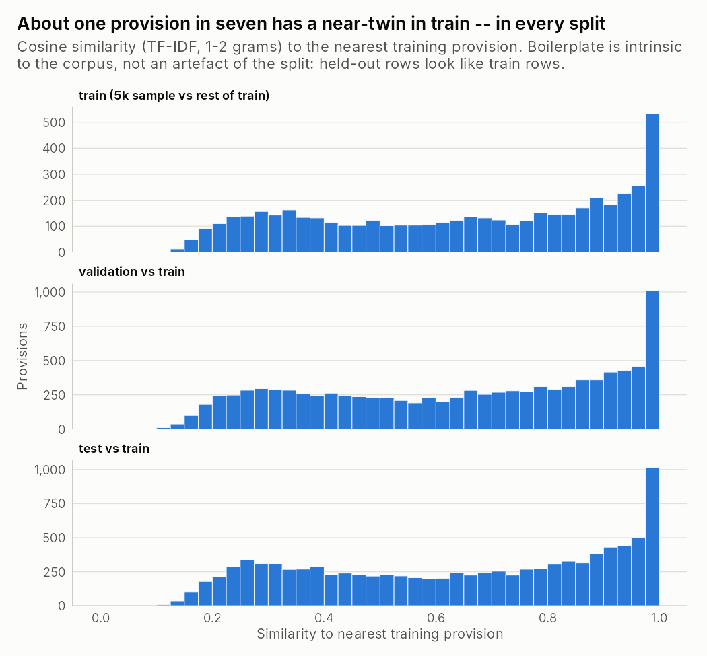<!-- -->

About 15% of test provisions have a near-identical twin (cosine ≥ 0.95)
in train. The same is true *within* train, so this is a property of
contract boilerplate rather than a flaw in the split, but it means part
of any score reflects recall of boilerplate (quantified in section 6).

### Class separability

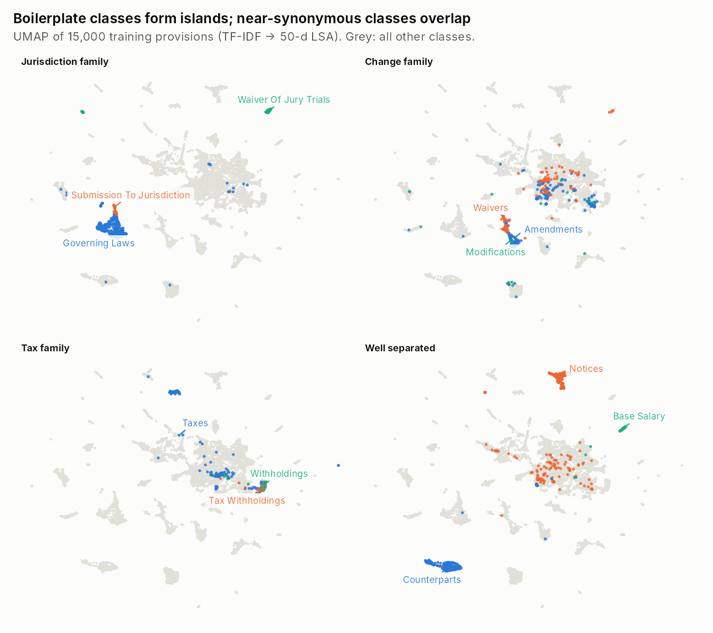<!-- -->

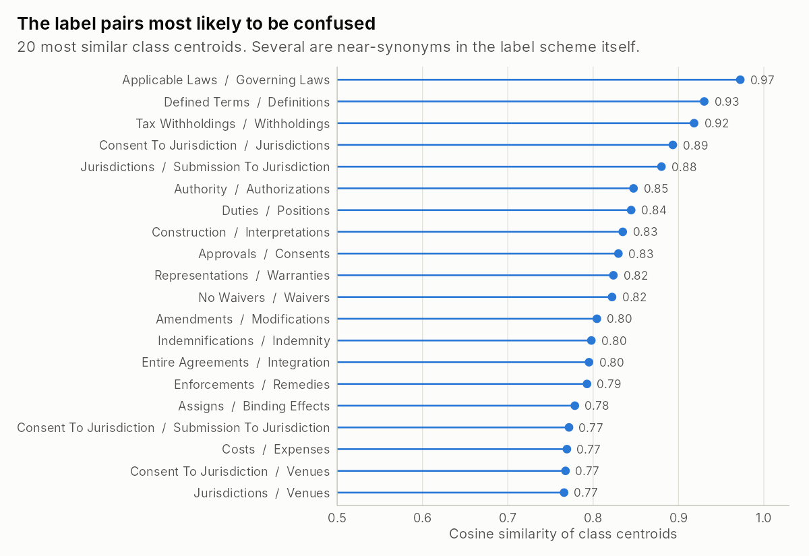

Boilerplate classes form isolated islands. The pairs with the most
similar centroids are near-synonyms in the label scheme itself
(Applicable Laws / Governing Laws, Defined Terms / Definitions, …).
These set a ceiling that is a property of the labels, not of the model.

## 2. Cleaning

`provisionr::clean_corpus()` applies the decisions above to the
**training split only** and logs each step:

| Step                                        | Rows removed | Rows left |
|:--------------------------------------------|-------------:|:----------|
| input                                       |            0 | 60,000    |
| fewer than 4 words                          |            2 | 59,998    |
| template duplicates with conflicting labels |           39 | 59,959    |
| repeats of an earlier template              |         2012 | 57,947    |

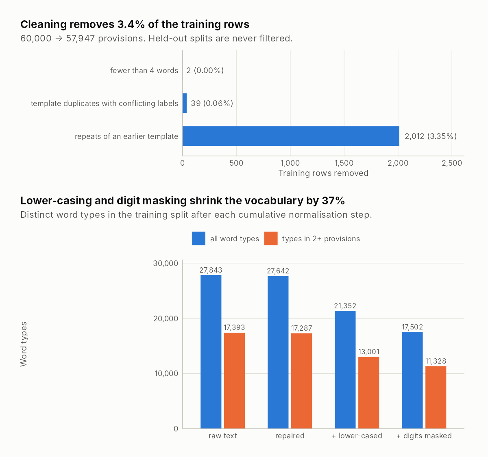

Held-out rows are never dropped. Whether de-duplication helps was
treated as an open question and tested on the validation split (section
4): accuracy 88.61% with cleaned training data versus 88.65% with raw,
i.e. no measurable difference — the step is kept because it removes
label noise and makes fold assignment honest, not because it buys
accuracy.

## 3. Features

All features are learned inside each training fold by `fit_featurizer()`
and applied with `bake_features()`. Candidate blocks: word n-gram
TF-IDF, character n-gram TF-IDF, a “head” block (n-grams of the opening
words only) and twelve dense surface statistics.

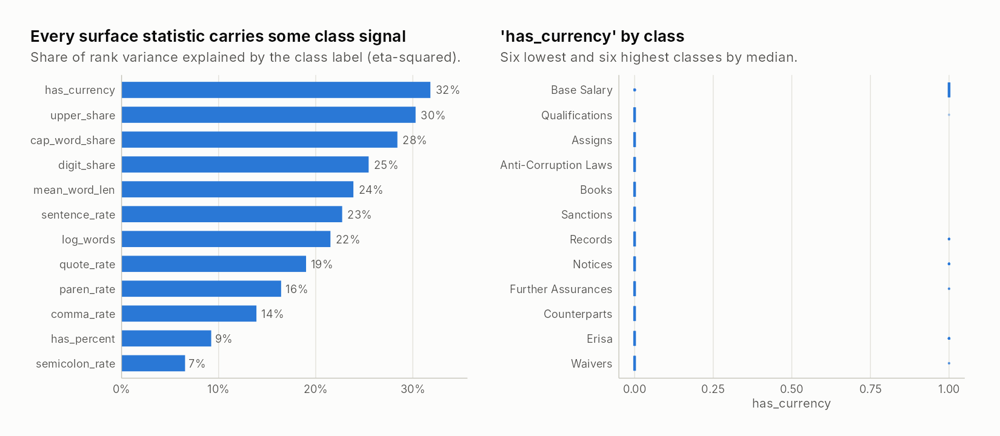<!-- -->

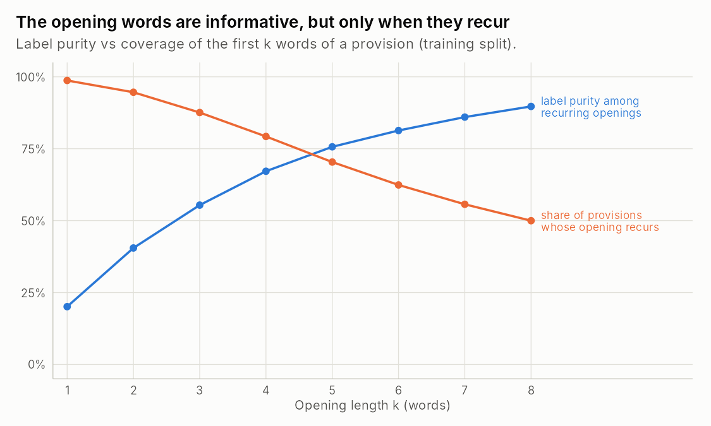

Each block shows class signal in isolation. Whether it *adds* signal on
top of word n-grams is a different question, answered by ablation.

### Ablation, round 1

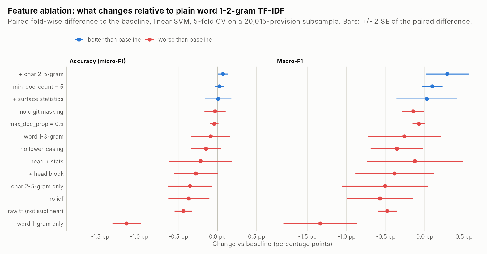<!-- -->

One change at a time against word 1-2-gram TF-IDF (linear SVM, C = 1,
20k subsample, fold-wise paired differences). Sub-linear tf, idf and
bigrams matter; everything else is within noise, and the head block
appeared to hurt.

### Ablation, round 2: a confound

Adding a unit-norm block rescales every document vector, which for an
SVM acts like changing C. Repeating the comparison across C and block
weights reverses the verdict on the head block:

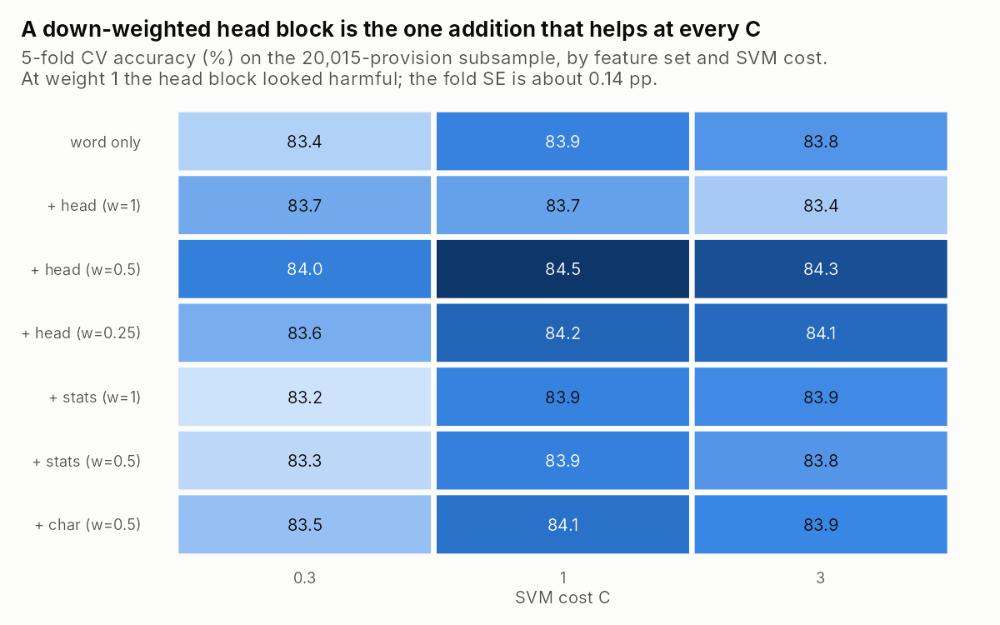

### Confirmation on the full training split

| Feature set                             | Features | CV accuracy    | CV macro-F1    |
|:----------------------------------------|:---------|:---------------|:---------------|
| word 1-2 (baseline)                     | 149,220  | 87.30% ± 0.18% | 81.57% ± 0.46% |
| word 1-2 + head (w=0.5)                 | 190,887  | 87.91% ± 0.14% | 82.46% ± 0.38% |
| word 1-2 + head (w=0.5) + stats (w=0.5) | 190,899  | 87.92% ± 0.15% | 82.50% ± 0.37% |

Selected: word 1-2-grams + head block (first 20 words, weight 0.5).
Character n-grams were dropped on cost (4× compute for a gain within
noise); surface statistics add nothing once n-grams are present.

## 4. Models

### Baselines

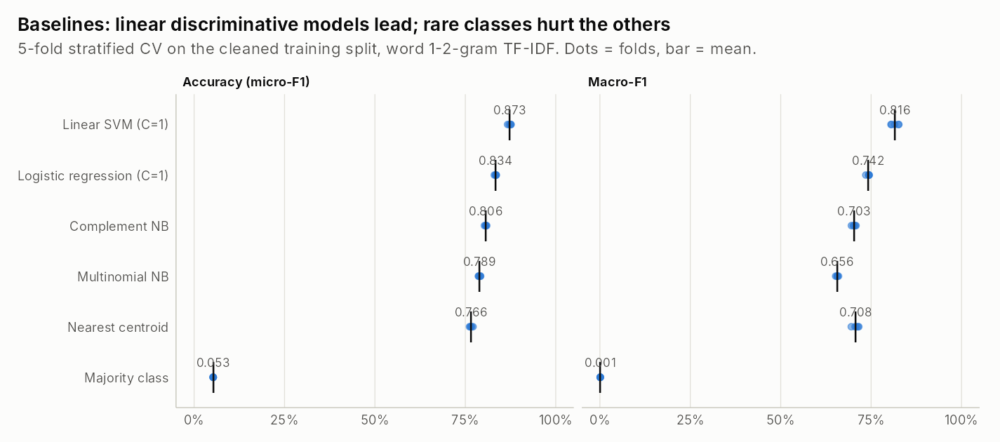<!-- -->

### Tuning

24 configurations from 7 families, same features and folds for all:

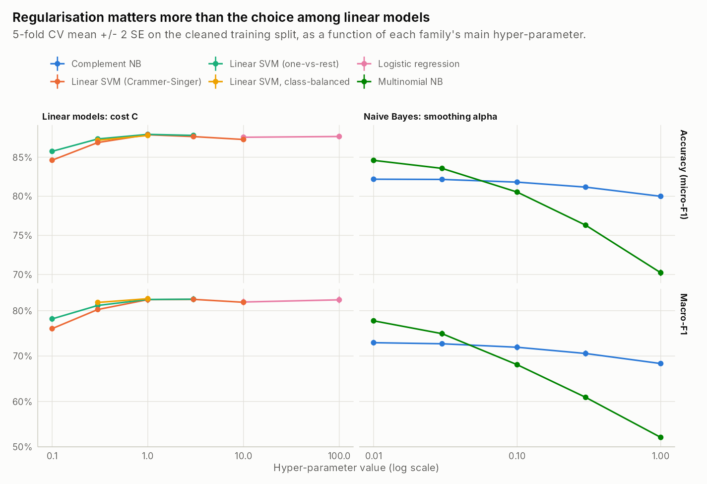<!-- -->

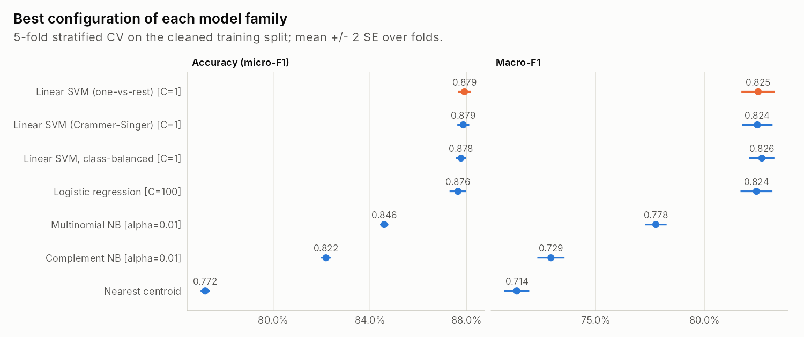<!-- -->

| Model                               | CV accuracy    | CV macro-F1    | Fit time (s) |
|:------------------------------------|:---------------|:---------------|-------------:|
| Linear SVM (one-vs-rest) \[C=1\]    | 87.91% ± 0.14% | 82.47% ± 0.39% |        125.3 |
| Linear SVM (Crammer-Singer) \[C=1\] | 87.87% ± 0.12% | 82.43% ± 0.35% |         28.2 |
| Linear SVM, class-balanced \[C=1\]  | 87.77% ± 0.11% | 82.64% ± 0.29% |        132.3 |
| Logistic regression \[C=100\]       | 87.64% ± 0.17% | 82.39% ± 0.37% |        477.5 |
| Multinomial NB \[alpha=0.01\]       | 84.59% ± 0.09% | 77.77% ± 0.25% |          1.7 |
| Complement NB \[alpha=0.01\]        | 82.18% ± 0.11% | 72.95% ± 0.31% |          2.6 |
| Nearest centroid                    | 77.18% ± 0.10% | 71.38% ± 0.29% |          0.8 |

### Selection and hold-out check

The CV winner is **Linear SVM (one-vs-rest) \[C=1\]**. Before touching
the test split, the best configuration of every family was fitted on the
full training split and scored on the validation split, which had not
been used for anything so far:

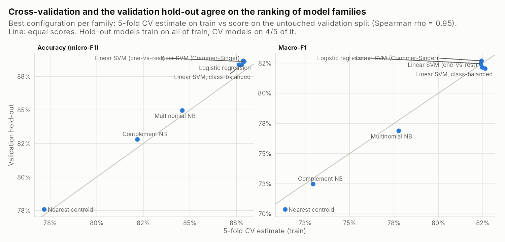<!-- -->

The ranking carries over (Spearman ρ = 0.95). Validation scores are, if
anything, slightly higher than the CV estimates; the hold-out models
were trained on all of the training split rather than four fifths of it.
The four tuned linear models are indistinguishable on validation as
well, so the choice among them is not consequential.

Two side questions were settled on the same hold-out:

| Model                                  | Validation accuracy | Validation macro-F1 |
|:---------------------------------------|:--------------------|:--------------------|
| xgboost on 100-d LSA                   | 81.0%               | 71.9%               |
| linear SVM on 100-d LSA                | 77.0%               | 63.2%               |
| linear SVM on sparse TF-IDF (selected) | 88.6%               | 82.1%               |

Gradient-boosted trees beat a linear model on the same 100 LSA
components, but both are far behind the linear model on the full sparse
representation: what matters is keeping the n-gram detail, not adding
non-linearity.

The selected configuration was then refitted on train + validation.

## 5. Validation of the final model

### Target shuffling

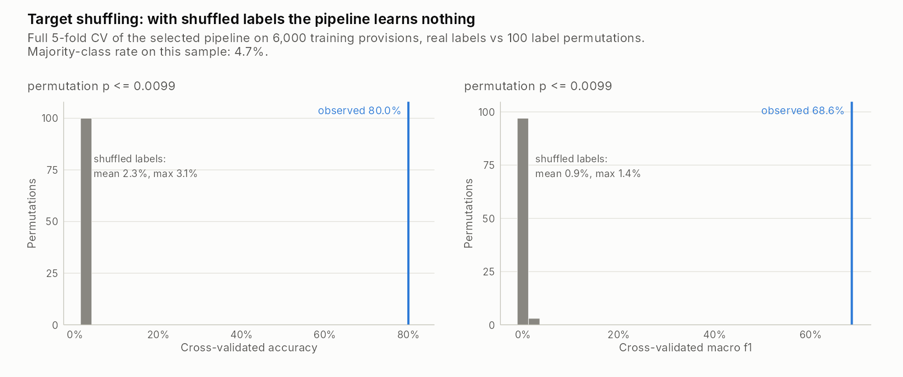<!-- -->

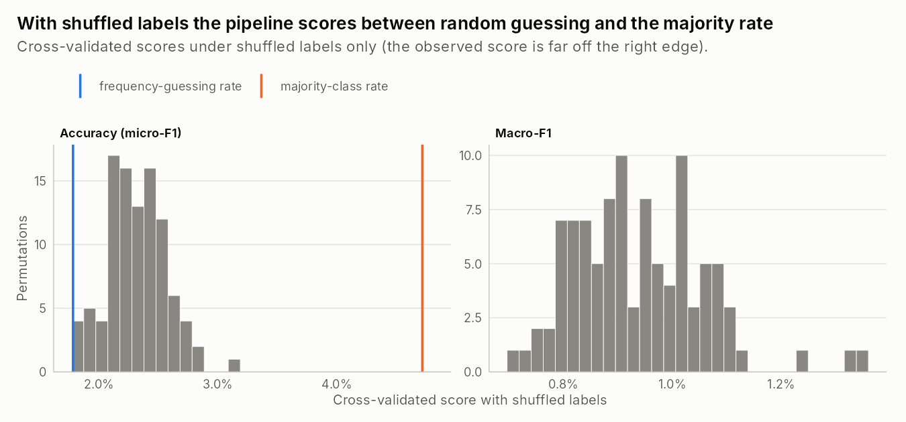

| Metric   | Observed | Null mean | Null max |   z | Permutation p |
|:---------|:---------|:----------|:---------|----:|--------------:|
| accuracy | 80.0%    | 2.31%     | 3.12%    | 321 |        0.0099 |
| macro_f1 | 68.6%    | 0.92%     | 1.44%    | 452 |        0.0099 |

### Held-out test split

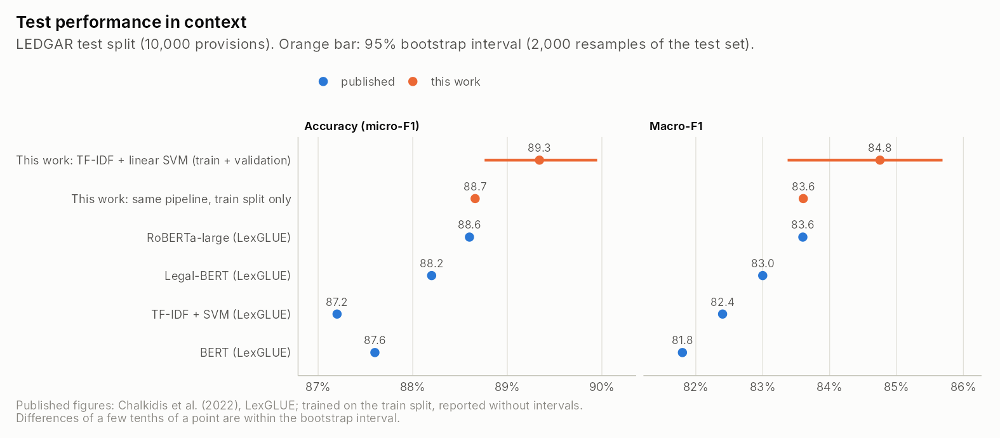<!-- -->

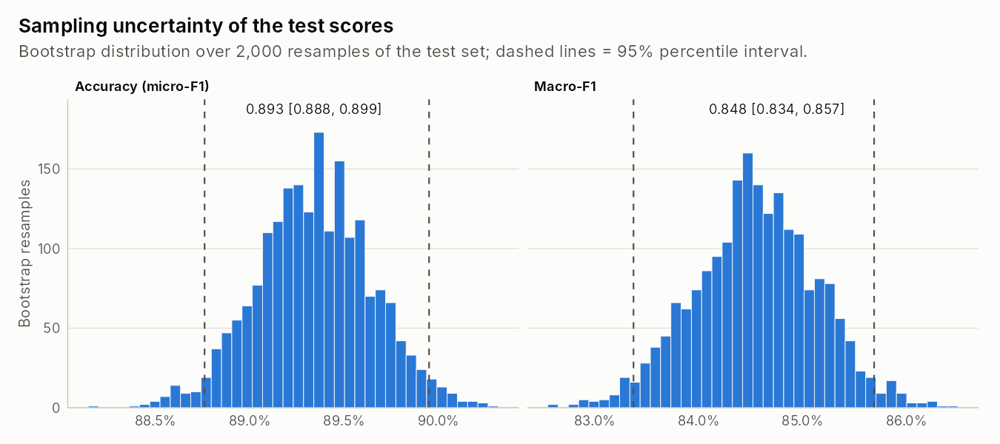

|   k | Top-k accuracy |
|----:|:---------------|
|   1 | 89.3%          |
|   2 | 94.5%          |
|   3 | 95.8%          |
|   5 | 96.8%          |
|  10 | 97.9%          |

### Per-class performance

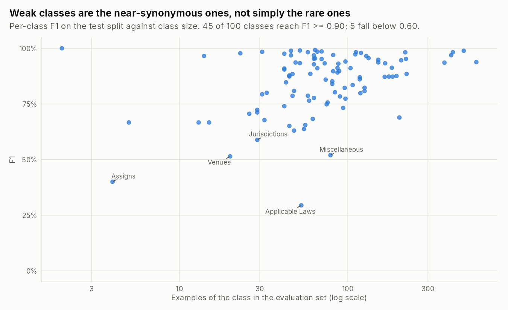<!-- -->

45 of 100 classes reach F1 ≥ 0.90 and 5 stay below 0.60. The weakest:

| Class           | Test examples | Precision | Recall | F1  |
|:----------------|--------------:|:----------|:-------|:----|
| Applicable Laws |            53 | 67%       | 19%    | 29% |
| Assigns         |             4 | 100%      | 25%    | 40% |
| Venues          |            20 | 60%       | 45%    | 51% |
| Miscellaneous   |            79 | 69%       | 42%    | 52% |
| Jurisdictions   |            29 | 68%       | 52%    | 59% |
| Agreements      |            48 | 92%       | 48%    | 63% |
| Modifications   |            55 | 81%       | 53%    | 64% |
| Enforceability  |            45 | 68%       | 62%    | 65% |
| Defined Terms   |            56 | 63%       | 68%    | 66% |
| Costs           |            15 | 67%       | 67%    | 67% |
| Powers          |            13 | 64%       | 69%    | 67% |
| Qualifications  |             5 | 75%       | 60%    | 67% |

### Confusions

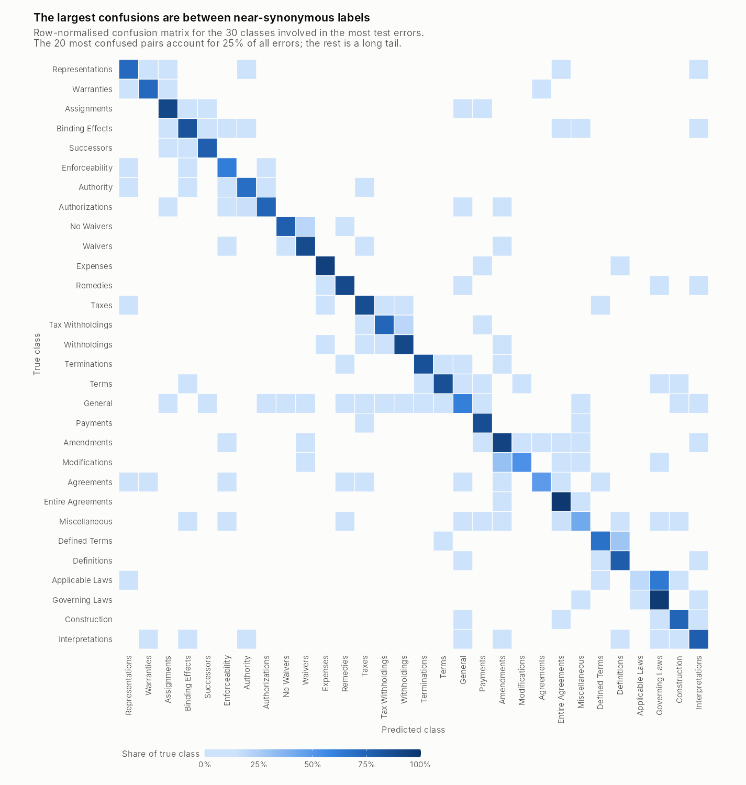<!-- -->

| True class       | Predicted as      | Errors | Share of true class |
|:-----------------|:------------------|-------:|:--------------------|
| Applicable Laws  | Governing Laws    |     34 | 64%                 |
| Definitions      | Defined Terms     |     17 | 14%                 |
| Integration      | Entire Agreements |     17 | 29%                 |
| Modifications    | Amendments        |     17 | 31%                 |
| No Waivers       | Waivers           |     17 | 20%                 |
| Defined Terms    | Definitions       |     16 | 29%                 |
| Tax Withholdings | Withholdings      |     15 | 20%                 |
| Authorizations   | Authority         |     14 | 16%                 |
| Miscellaneous    | Entire Agreements |     12 | 15%                 |
| Successors       | Binding Effects   |     12 | 12%                 |

### Confidence

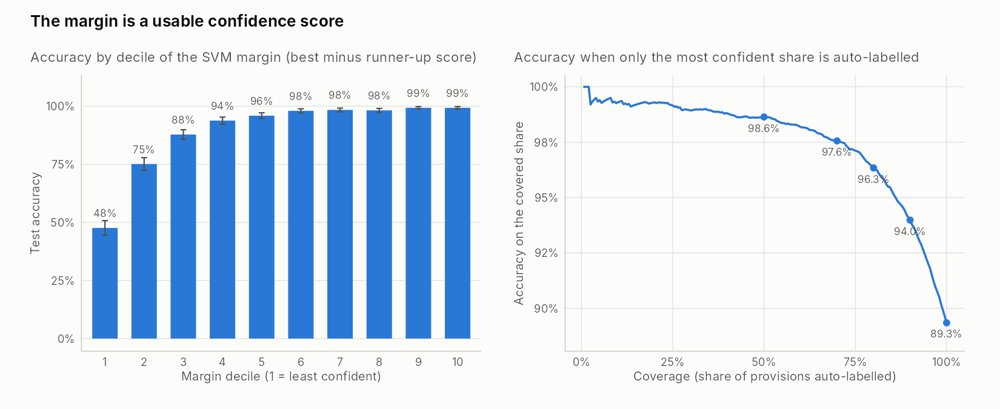<!-- -->

The SVM margin orders predictions well: auto-labelling only the most
confident 70% of provisions gives 97.6% accuracy on that share, and
94.0% at 90% coverage.

## 6. Robustness

### Boilerplate

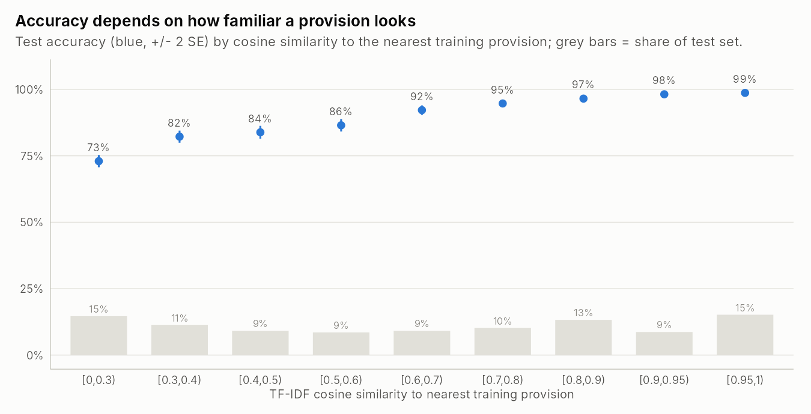<!-- -->

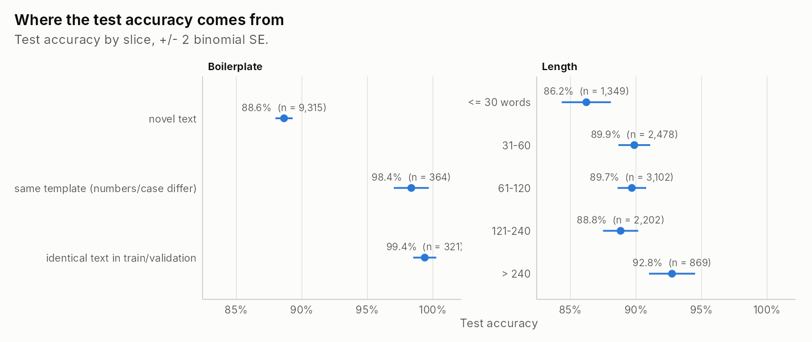<!-- -->

| Scheme                                        | CV accuracy    | CV macro-F1    |
|:----------------------------------------------|:---------------|:---------------|
| stratified 5-fold (twins may straddle folds)  | 88.52% ± 0.11% | 83.21% ± 0.20% |
| grouped 5-fold (template twins kept together) | 88.07% ± 0.14% | 82.53% ± 0.26% |

Keeping template twins in the same fold lowers the CV estimate by 0.4
pp: exact boilerplate repeats inflate a naive CV a little, which is one
reason the training split was de-duplicated before any resampling.
Similarity to the training data matters far more broadly, as the first
figure shows: accuracy rises from 73% for provisions unlike anything in
train to 99% for near-twins.

### Temporal drift

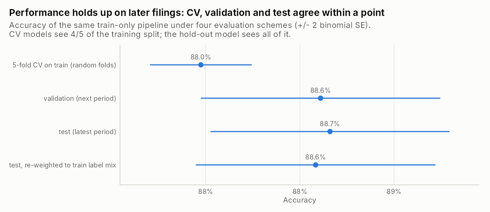<!-- -->

The label mix of the test split differs significantly from train
(section 1), yet the train-only model does no worse on the later splits
than random-fold CV predicted: 88.0% (CV) → 88.6% (validation) → 88.7%
(test). Re-weighting the test rows to the training label mix changes
test accuracy by only -0.1 pp. Two caveats: CV models are trained on
four fifths of the data, which by the learning curve below costs roughly
half a point, and each hold-out number carries about ±0.6 pp of sampling
error (2 SE). Within that resolution there is no sign that the model
degrades on newer filings — over the two periods this corpus covers.

### Learning curve

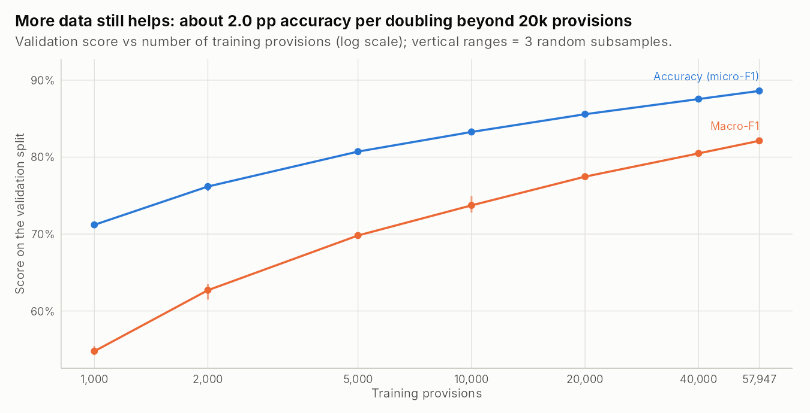<!-- -->

### Resampling noise

| Metric   | Mean   | SD between folds | SD between repeats |
|:---------|:-------|:-----------------|:-------------------|
| accuracy | 87.97% | 0.26 pp          | 0.11 pp            |
| macro_f1 | 82.41% | 0.51 pp          | 0.08 pp            |

## 7. Comparison with a fine-tuned transformer

To see what a pretrained language model adds, an open-source
legal-domain encoder was fine-tuned on the same data:
**Legal-BERT-small** (`nlpaueb/legal-bert-small-uncased`, 35M
parameters, CC-BY-SA-4.0). The protocol mirrors the SVM study — weights
trained on the train split only, epoch and hyper-parameters chosen on
validation, the test split scored once at the end — so the like-for-like
counterpart is the SVM fitted on the train split only.

**Compute constraint.** The environment has 4 CPU cores and no GPU. That
dictated the model (Legal-BERT-base would have needed about 2.6 hours
per epoch) and the budget: 3 epochs at 256 word pieces, 2.9 hours of
training. Learning rate and input length were chosen in five small pilot
runs (`results/14_pilot_runs.csv`). Published LEDGAR results for
transformers use larger models and up to 20 epochs on GPUs, so this is a
comparison at equal *data*, not at equal *effort*.

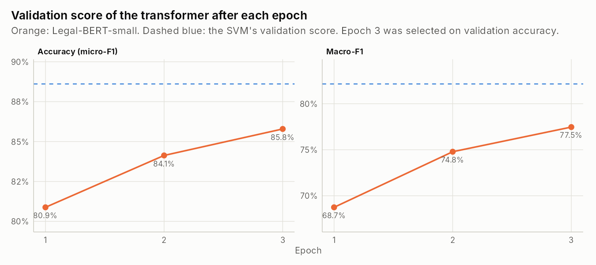<!-- -->

Validation accuracy was still rising at the last epoch (80.9% → 84.1% →
85.8%), so the transformer had not converged within this budget; more
epochs would probably narrow the gap reported below, though the
per-epoch gain was already shrinking.

### Headline

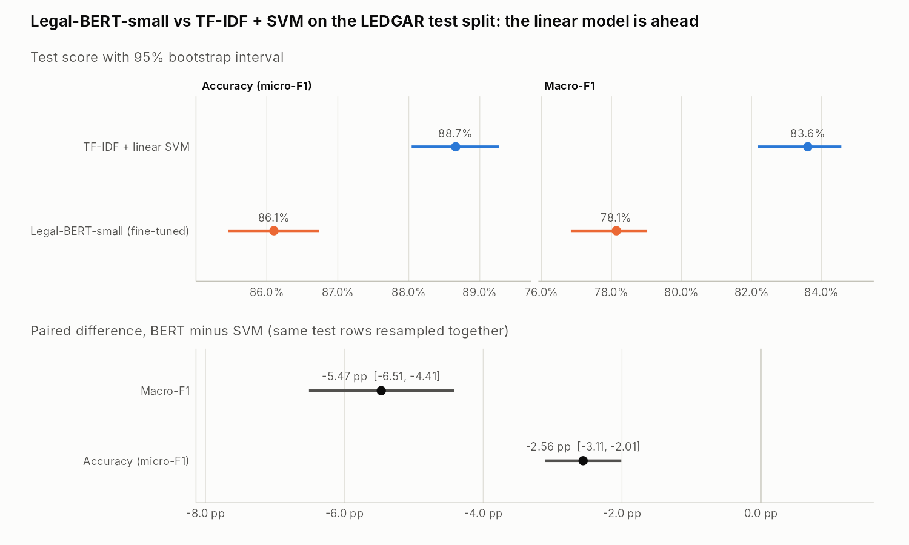<!-- -->

| Model                         | Accuracy (micro-F1)    | Macro-F1               |
|:------------------------------|:-----------------------|:-----------------------|
| TF-IDF + linear SVM           | 88.7% \[88.0%, 89.3%\] | 83.6% \[82.2%, 84.6%\] |
| Legal-BERT-small (fine-tuned) | 86.1% \[85.5%, 86.7%\] | 78.1% \[76.8%, 79.0%\] |

On accuracy the transformer is -2.56 pp relative to the SVM (95%
paired-bootstrap interval -3.11 pp to -2.01 pp; exact McNemar p =
2.2e-20), and on macro-F1 -5.47 pp (-6.51 pp to -4.41 pp).

| Outcome           | Test provisions | Share |
|:------------------|:----------------|:------|
| both correct      | 8,351           | 83.5% |
| only SVM correct  | 515             | 5.1%  |
| only BERT correct | 259             | 2.6%  |
| both wrong        | 875             | 8.8%  |

The SVM is the better model here, clearly so on macro-F1: the fine-tuned
network is weaker on small and confusable classes.

### Where they differ

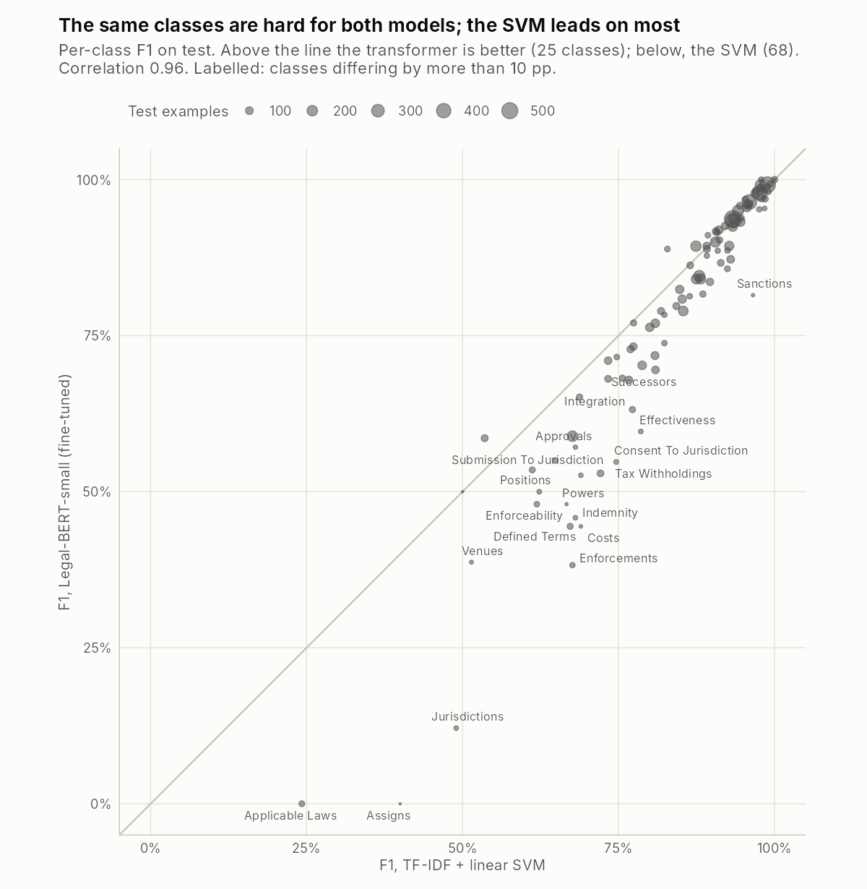

The SVM has the higher F1 on 68 of 100 classes, the transformer on 25.
Both find the same classes hard (correlation of per-class F1 0.96), but
the transformer collapses on some rare or near-synonymous ones — it
never correctly predicts *Applicable Laws* or *Assigns*.

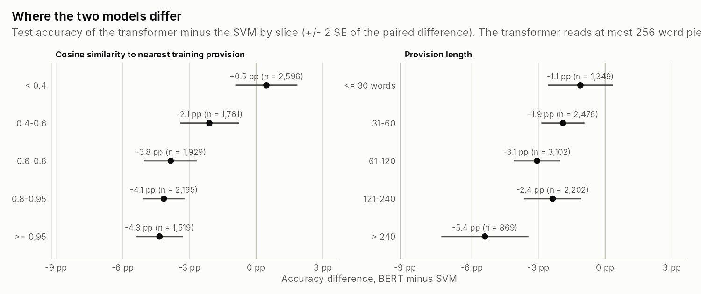<!-- -->

The gap is not uniform. On provisions unlike anything in the training
data (similarity below 0.4) the two models are tied (75.7% vs 75.2%).
The SVM’s lead comes from familiar boilerplate, where exact n-gram
matches are decisive, and from the longest provisions, which the
transformer only reads up to 256 word pieces (12% of provisions are
truncated).

### Do they complement each other?

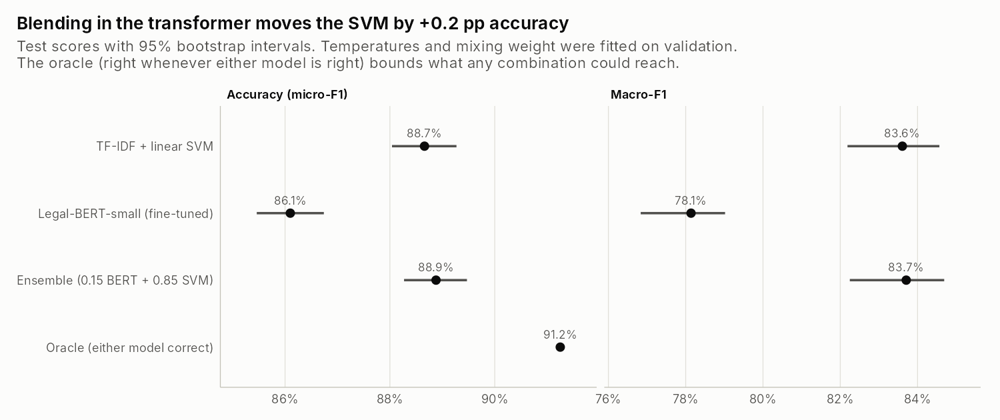<!-- -->

Only a little. A weighted average of the two models’ probabilities
(temperatures and weight fitted on validation) improves on the SVM by
+0.22 pp accuracy (95% interval +0.03 pp to +0.42 pp), with no reliable
change in macro-F1. At least one of the two models is right on 91.2% of
test provisions, so their errors overlap heavily.

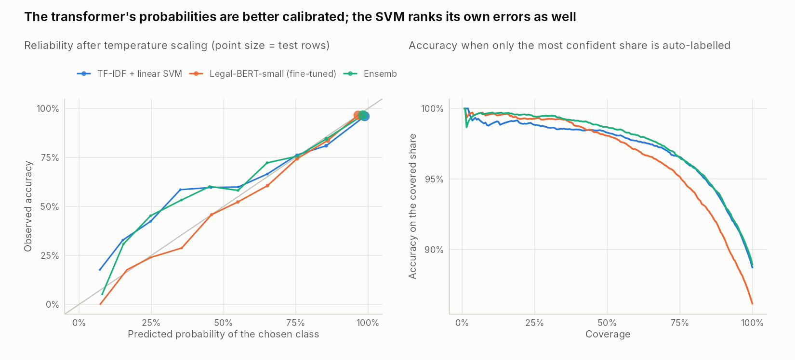<!-- -->

The transformer’s temperature-scaled probabilities are better calibrated
(expected calibration error 0.8% vs 4.1% for the SVM’s soft-maxed
margins). For deciding which predictions to trust, the SVM’s confidence
ranking is at least as good.

### Cost

| Model                         | Parameters | Training time | Time to score 10,000 provisions | Hardware    |
|:------------------------------|:-----------|:--------------|:--------------------------------|:------------|
| TF-IDF + linear SVM           | 21,619,300 | 2.6 min       | 4 s                             | 1 CPU core  |
| Legal-BERT-small (fine-tuned) | 35,119,716 | 176.9 min     | 109 s                           | 4 CPU cores |

(The SVM training time is the measured cross-validation fit time scaled
to the full training split.)

**Takeaway.** With the data and hardware available here, the sparse
linear model is more accurate, about 68 times cheaper to train and about
29 times faster to apply. That is not a general verdict on transformers
for this task: larger published models trained for longer on GPUs reach
88.2–88.6% accuracy, level with the SVM. Taken together, the evidence
suggests that on LEDGAR a pretrained encoder needs far more compute to
match a well-tuned bag of n-grams, and does not clearly beat it even
then.

## 8. Limitations

- Test accuracy describes filings from the period right after the
  training data. Performance on later or structurally different
  contracts will be lower and should be monitored.
- Selecting one of 24 configurations by CV biases the CV estimate of the
  winner upward slightly; the validation and test scores are free of
  that bias, which is why they are the numbers to quote.
- The bootstrap interval reflects test-set sampling only, not the
  variability of retraining.
- The comparison with published results is indicative only: those are
  different training runs without reported intervals, and the final
  model here also uses the validation split.
- Linear models over n-grams cannot use context outside the provision,
  and the hardest label pairs are near-synonyms. That published
  transformer models score about the same suggests label ambiguity,
  rather than model capacity, is the binding constraint on this
  benchmark.
- The margin is a ranking score, not a calibrated probability.

## Reproducing

``` sh
cd ledgar
make setup   # R packages + provisionr
make all     # steps 01-13 and this report
```

The process itself is tracked as tickets on an epiq board (snapshot in
`docs/epiq/board.md`); every commit subject starts with its ticket ref.
